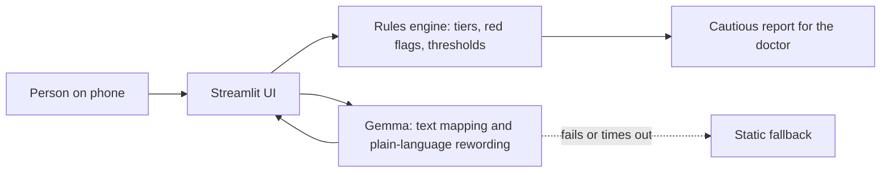

<div align="center">

# Diabetes-

### Your doctor sees you for a few minutes every few months.<br>This app watches the weeks in between.

A bilingual (English / বাংলা) diabetes companion for Bangladesh, powered by open-weight **Gemma**.<br>
It catches the quiet warning signs in your feet, eyes, kidneys, nerves and heart, and turns them into a calm, cautious report to bring to your doctor.

[Live demo](https://diabetesminus.streamlit.app/) &nbsp;|&nbsp;|&nbsp; MIT License &nbsp;|&nbsp; Built solo in one Hack Day

</div>


---

## 13.9 million adults. Most of the damage is silent.

The IDF Diabetes Atlas estimates **13.9 million adults in Bangladesh live with diabetes**, climbing to **23.1 million by 2050**. About **39% of cases are undiagnosed**. Bangladesh has the second-highest prevalence in South-East Asia ([IDF Diabetes Atlas](https://diabetesatlas.org/data-by-location/country/bangladesh/)).

And diagnosis is only the beginning. Diabetes rarely hurts early. The harm to feet, eyes, kidneys, nerves and heart builds quietly, in the long gaps between appointments, in a health system where consultations are short and follow-up is thin.

Most diabetes apps record numbers, in English, for people who already understand them. **This one reads the pattern, speaks plain Bangla, and tells you what is worth raising with your doctor.**

## Rahim's two weeks

Rahim is 52, type 2, on metformin and night-time insulin. He logs his sugar and takes his tablets. He is doing everything right.

- **Day 1-14:** his feet tingle. He blames the weather.
- **Day 6:** a small blister on his heel. It doesn't hurt, so he ignores it.
- **Twice that fortnight:** he wakes at night shaky and sweating. A low. He tells nobody.
- **Visit day:** the doctor has minutes. Rahim says "my sugar is okay." Nobody connects the dots.

**With Diabetes-:** the tingling logged on 12 of 14 days, the ignored blister and the night lows come together in one report:

> *This pattern may be worth discussing with your doctor this week. Loss of feeling without pain is not reassuring. Other possible reasons: long-term metformin (B12), alcohol, recent illness. Questions to ask: ...*

No diagnosis. No panic. Just the right thing in front of the right person at the right time. (Rahim is a fictional demo patient. Load him in one tap.)

## What it does

| | |
|---|---|
| **Log in seconds** | Glucose, food (type "2 ruti and dal"), medicine and insulin, water, exercise, energy, mood. |
| **Meal and insulin safety** | "Skipping a meal" or "sleeping after insulin" shows your latest sugar status, **your own doctor's plan word for word**, and fixed low-sugar steps. No plan yet? It tells you not to guess. |
| **Complication-aware symptom guide** | Not a chatbot. Fixed question sets for foot and nerve problems, night lows, and thirst and high sugar. |
| **A report your doctor can use** | What you noticed, for how long, getting worse or not, and **what else could explain it**. Plus a ready question pack. |
| **Emergency in two taps** | Red-flag checklists for heart, stroke, severe low, very high sugar and foot infection. Call 999 or alert a trusted person by call, WhatsApp or SMS. |
| **Reminders** | HbA1c, eye, kidney, foot, lipid and blood pressure checks. |
| **Learn** | Plain-language glossary, myth-busting cards and analogies (insulin resistance as a sticky lock). |

## Why this is different

**1. It watches for complications, not just glucose.** The expensive, life-changing outcomes are amputations, blindness and kidney failure. Diabetes- is built around the early signs of those, between visits.

**2. Rules decide. Gemma explains.** In health, an AI that guesses is a hazard, so we drew a hard line:

| Deterministic Python decides | Gemma (open-weight) does |
|---|---|
| Emergency red flags | Maps your words to the right symptom module |
| Four urgency tiers | Parses typed food into our food list |
| Glucose thresholds, low-sugar rules | Pulls symptom keys out of a check-in note |
| Report caps and confounder logic | Rephrases a **static fact sheet** in simpler words |
| Which question to ask next | Maps an "Other" answer to the nearest option |

Gemma never declares an emergency, never invents a question, never diagnoses, never touches a dose. If the model is slow or offline, every feature has a static fallback and the app still works.



**3. Built to be calm, not scary.** Four tiers (emergency, this week, next visit, self-care). One symptom alone never goes above "next visit" (one defined exception: a foot wound). Maximum one "this week" and two "next visit" items per report. Other explanations like fasting, illness, a new medicine or missed doses can only **lower** urgency, never raise it.

**4. True Bangla, not translated Bangla.** Every screen is fully English or fully বাংলা, never mixed. Bangla numerals, simple spoken-formal wording, drug names in Bangla script, pre-written content rather than live machine translation.

**5. Designed like a product, not a hackathon demo.** An Apple-inspired design system in pure CSS and Python (no JavaScript): single-column mobile-first layout, instant press feedback, translucent materials, and full support for reduced-motion, reduced-transparency and high-contrast settings.

## Open source, open weights, on purpose

Diabetes- runs on **Gemma** through a one-line provider switch in `ai.py`:

- `gemma` : Gemma through the Gemma API, used in the hosted demo.

Why open weights matter here: health data is intimate, connectivity is uneven, and a tool for Bangladesh shouldn't depend on one vendor's terms. An open model can be hosted by a hospital, run on a clinic laptop, or fine-tuned for Bangla medical language, while the safety rules around it stay unchanged and auditable. The whole project is **MIT licensed** so clinicians, NGOs and developers can inspect it, fix it and build on it.

## Safety and privacy by design

- **No diagnosis, no doses.** Wording is "this pattern may be worth discussing", never "you have X". Insulin guidance is only ever your own doctor's entered plan.
- **Emergency first.** Free text mentioning chest pain, stroke signs or self-harm goes to the emergency screen before anything else.
- **Every clinical rule is flagged.** Each threshold and rule in the code is tagged `# VERIFY` for clinician review.
- **No accounts, no database, no email.** Data lives in the browser session. Export and import is a validated JSON file you control (1 MB cap).
- **Always-visible disclaimer** with the emergency number.

## Judging criteria, mapped

| Criterion | Weight | Where to look |
|---|---|---|
| Open source and model use | 30% | MIT repo; Gemma via `ai.py` with Gemini/Ollama switch; five narrow Gemma jobs with static fallbacks; Gemma never in the safety path |
| Innovation | 20% | Complication-aware screening between visits; confounder-aware reports; "rules decide, Gemma explains" architecture |
| Social impact | 20% | Bangladesh's diabetes burden; Bangla-first; doctor-ready reports for short consultations; local-model privacy path |
| Creativity | 15% | The doctor's plan loops back into meal safety; painless numbness treated as *not* reassuring; the anti-alarm tier system |
| Design and usability | 15% | Apple-inspired CSS-only design system; mobile-first; accessibility media queries; real Bangla typography |

## Try it in 2 minutes

1. Open the [live demo](https://diabetesminus.streamlit.app/) and choose English or বাংলা.
2. Load **Rahim**. His logs and concern trackers are on the dashboard.
3. Open "I'm skipping a meal / going to sleep after insulin". It says **no doctor plan yet**.
4. Use "I went to the doctor today" and save a plan. The safety screen now shows it word for word.
5. Open **Symptom guide**, describe tingling feet, answer the foot questions, then open **Report**.
6. Tap **Emergency** to see the red-flag flow.
7. Load **Salma** to see the metformin note, confounder handling and the cardiac checklist.

## Project layout

```
app.py             entry point: language gate, header, sidebar
base.py            config, i18n (en/bn), session state, glucose rules
ai.py              Gemma wrapper (Gemini or Ollama), prompts, fallbacks
engine.py           triage, tiers, red flags, reminders, report builder
content_q.py        fixed symptom question modules
content_learn.py    glossary, confounders, cards, explainers
data_misc.py        Bangladeshi foods, matching, demo patients
ui.py               the only place CSS lives, plus UI helpers
pages_*.py          home, profile, safety, symptom guide, report, learn
```

## Honest limits

A prototype built in one day. Not clinically validated, not a medical device. Thresholds and question sets need review by Bangladeshi diabetologists, and the Bangla needs review by native and clinical readers. Data is session-only by design, so there are no push reminders. There is no automated test suite yet.

---

Built by **Farhan Bin Mir Hassan** for Hacktoberfest Hack Day Dhaka, entered for **Best Use of Gemma**. Statistics: IDF Diabetes Atlas. Released under the MIT License.

<sub>Educational prototype. It does not diagnose, treat or replace professional care. In an emergency, call 999.</sub>
